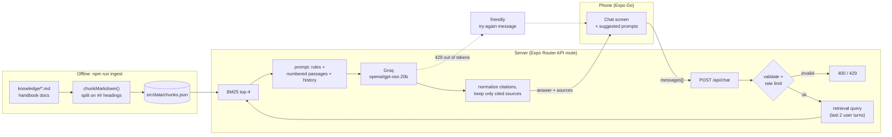

# Handbook RAG Chatbot (Expo Go + Groq)

A lightweight mobile chatbot that answers questions about a company handbook using **naive RAG** (retrieval-augmented generation). It runs in **Expo Go** with no native build. Retrieval uses plain **BM25 keyword search** (no vector database, no embeddings API), and answers come from an LLM on **Groq**, with **clickable source citations**.

The knowledge base is a fictional handbook for *Brindlewick Robotics*. Because the company is made up, the model can't answer from memory: every correct answer has to come from retrieval.

## Features

- 💬 **Chat UI** for iOS, Android and web via Expo Router
- 🔎 **BM25 retrieval** over Markdown chunks, with zero extra dependencies
- 📎 **Cited answers**: the model cites passages as `[1]`, `[2]`, and each reply has a **Show sources** toggle with the exact passages
- ⚡ **Suggested prompts**: tap to send, including one the handbook can't answer, to show the "I don't know" behaviour
- 🧠 **Follow-up aware**: retrieval uses the last two user turns, so "And in capital cities?" still finds the hotel policy
- 🛡️ **Safe by default**: the API key stays on the server, input is validated, requests are rate limited, security headers are set, and errors are generic
- 🚦 **Graceful limits**: if Groq's token or rate limit is hit, the user sees a friendly "try again in a minute" message instead of a crash
- ✅ **Tested**: 17 unit tests (Node's built-in runner) plus a retrieval check (hit@4 = 18/18)

## How it works



1. **Ingest (once):** each handbook file is split on `##` headings. Every chunk is prefixed with its heading path (`Leave Policy > Sick leave`), which helps keyword matching.
2. **Retrieve:** BM25 scores every chunk against the user's latest question plus the one before it, and the top 4 are kept.
3. **Augment:** the chunks are numbered `[1]`–`[4]` in the system prompt. The model is told to answer only from them, cite them, and say "I don't know" otherwise.
4. **Generate:** Groq returns the answer. The server keeps only the sources the answer actually cites and sends both to the app.

## Project structure

```
knowledge/                 Fictional handbook (9 Markdown files) + evals.json (21 test questions)
chatbot/
  src/app/index.tsx        Chat screen
  src/app/api/chat+api.ts  Server route: rate limit → handleChat → Groq
  src/components/          MessageBubble (sources toggle), SuggestedPrompts, ChatInput
  src/hooks/use-chat.ts    Client state + fetch
  src/lib/                 Pure, unit-tested RAG logic
    chunk.ts               Markdown → chunks
    search.ts              BM25 ranking
    prompt.ts              Retrieval query + prompt builder
    chat.ts                Validate → retrieve → generate → cite; error handling
    validate.ts            Request validation
    rate-limit.ts          Fixed-window rate limiter
  scripts/ingest.mts       Builds src/data/chunks.json
  scripts/eval-retrieval.mts  Checks each eval question retrieves its expected source
```

## Getting started

**Requirements:** Node 22.6+ (tested on 24), the Expo Go app on your phone, and a free [Groq](https://groq.com) API key.

```bash
cd chatbot
npm install
echo "GROQ_API_KEY=your_key_here" > .env   # server-only; never prefix with EXPO_PUBLIC_
npx expo start
```

Scan the QR code with the Camera app (iOS) or Expo Go (Android). Your phone must be on the same Wi-Fi network as your computer. If it can't connect, try `npx expo start --tunnel`.

### Configuration (`chatbot/.env`)

| Variable | Default | Purpose |
|---|---|---|
| `GROQ_API_KEY` | (required) | Groq API key, read only by the server route |
| `GROQ_MODEL` | `openai/gpt-oss-20b` | Any chat model available on your Groq account |
| `EXPO_PUBLIC_API_URL` | dev server | Base URL of the deployed API (HTTPS) for production builds |

## Scripts

```bash
npm test         # 17 unit tests (node --test)
npm run ingest   # rebuild chunks.json after editing knowledge/*.md
npm run eval     # retrieval hit@4 over knowledge/evals.json
```

## Use your own documents

Replace the files in `knowledge/` with your own Markdown, using `#` for the title and `##` for each section. Then run `npm run ingest`, update `knowledge/evals.json` with questions about your content, and run `npm run eval`.

## Known limitations (deliberate, to keep it lightweight)

- **Keyword search, not semantic search:** BM25 misses paraphrases (for example, "vacation" vs "annual leave"). Swap `search.ts` for embeddings if your users phrase questions differently from your docs.
- **In-memory rate limiter:** works per server instance only.
- **No streaming or chat persistence:** answers arrive in one piece, and the chat resets when the app restarts.
